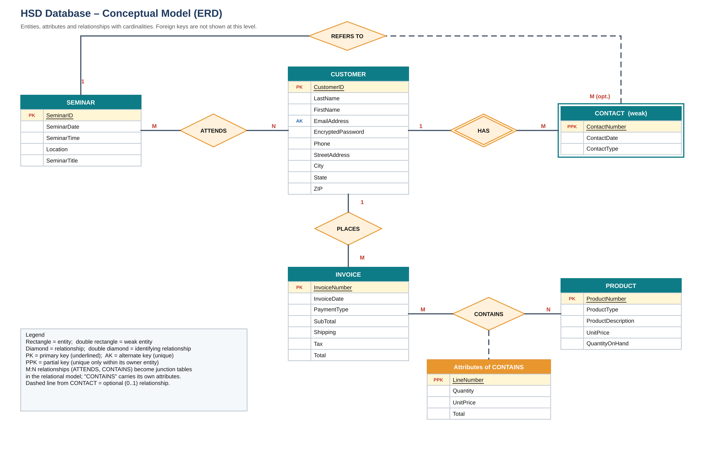
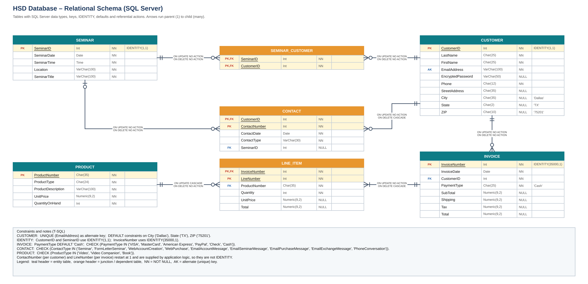
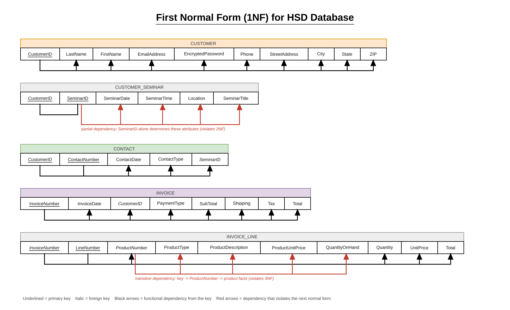
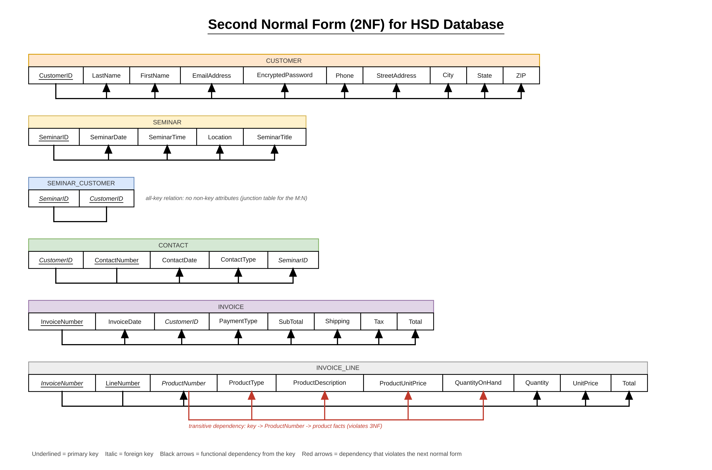
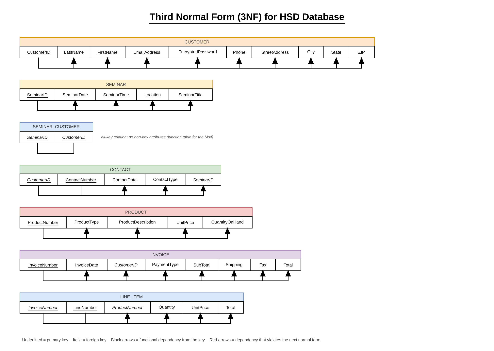

# HSD Database – Heather Sweeney Designs

A complete database design and implementation for **Heather Sweeney Designs (HSD)**, an interior-design company that runs free kitchen-design seminars and sells books, videos and consulting services.
The project goes from business case to working **Microsoft SQL Server (T-SQL)** code: conceptual model, relational model, normalization, table creation, data loading, queries, views and a user-defined function.


---

## Table of contents
- [Business case](#business-case)
- [Database design](#database-design)
  - [1. Conceptual model (ERD)](#1-conceptual-model-erd)
  - [2. Relational model](#2-relational-model)
  - [3. Normalization](#3-normalization)
- [Tables](#tables)
- [Getting started](#getting-started)
- [Scripts](#scripts)
- [Project structure](#project-structure)
- [Notes](#notes)
- [License](#license)

---

## Business case
Heather Sweeney runs free seminars at home shows, kitchen and appliance stores and other venues to build a customer base. Income comes from selling books and videos and from custom-design consulting. After each seminar she follows up with every attendee, so the database must record:

| Need | Stored in |
|---|---|
| **Who** – the customers | `CUSTOMER` |
| **Where** – the seminars each customer attended | `SEMINAR`, `SEMINAR_CUSTOMER` |
| **How she reached out** – seminar visits, emails, form letters, web account creation, calls | `CONTACT` |
| **What was sold** – invoices and their line items | `INVOICE`, `LINE_ITEM`, `PRODUCT` |

## Database design

### 1. Conceptual model (ERD)
Entities, attributes, relationships and cardinalities. `CONTACT` is a weak entity of `CUSTOMER`; the many-to-many relationships (`ATTENDS`, `CONTAINS`) become junction tables in the relational model.



Editable source: [`Conceptual_ERD.drawio`](docs/conceptual/Conceptual_ERD.drawio)

### 2. Relational model
Tables with SQL Server data types, primary/foreign keys, `IDENTITY` columns, defaults and the referential actions (`ON UPDATE` / `ON DELETE`).



Editable source: [`Relational_Schema.drawio`](docs/relational/Relational_Schema.drawio)

### 3. Normalization
The design is normalized step by step. Arrows show functional dependencies; red arrows show a dependency that the next normal form removes.

| Step | What changes |
|---|---|
| **1NF** | Repeating groups moved into their own relations |
| **2NF** | `CUSTOMER_SEMINAR` split into `SEMINAR` and `SEMINAR_CUSTOMER` (partial dependency removed) |
| **3NF** | `INVOICE_LINE` split into `PRODUCT` and `LINE_ITEM` (transitive dependency removed) |





Editable source (3 pages): [`Normalization_1NF_2NF_3NF.drawio`](docs/normalization/Normalization_1NF_2NF_3NF.drawio)

## Tables

| Table | Purpose | Key |
|---|---|---|
| `CUSTOMER` | People Heather wants to contact and sell to | `CustomerID` |
| `SEMINAR` | Seminars (date, time, location, title) | `SeminarID` |
| `SEMINAR_CUSTOMER` | Which customer attended which seminar (M:N) | `SeminarID, CustomerID` |
| `CONTACT` | Every contact made with a customer | `CustomerID, ContactNumber` |
| `PRODUCT` | Books, videos and video companions | `ProductNumber` |
| `INVOICE` | A customer's purchase (numbers start at 35000) | `InvoiceNumber` |
| `LINE_ITEM` | The products on each invoice | `InvoiceNumber, LineNumber` |

Expected row counts after loading the sample data: `CUSTOMER` 12, `SEMINAR` 6, `SEMINAR_CUSTOMER` 14, `CONTACT` 42, `PRODUCT` 10, `INVOICE` 17, `LINE_ITEM` 50.

## Getting started

**Requirements:** Microsoft SQL Server (2017 or later recommended) and SQL Server Management Studio (SSMS) or `sqlcmd`.

### With SSMS
Open each script from the `sql/` folder and execute them **in numeric order** (01 → 04).

### With sqlcmd
```bash
sqlcmd -S localhost -E -i sql/01-HSD-Create-Tables.sql
sqlcmd -S localhost -E -i sql/02-HSD-Insert-Data.sql
sqlcmd -S localhost -E -i sql/03-HSD-Queries.sql
sqlcmd -S localhost -E -i sql/04-HSD-Create-Views-and-Functions.sql
```
(`-E` uses Windows authentication; use `-U <user> -P <password>` for SQL authentication.)

## Scripts

| Order | File | Description |
|---|---|---|
| 1 | [`01-HSD-Create-Tables.sql`](sql/01-HSD-Create-Tables.sql) | Creates the `HSD` database, the seven tables with keys, defaults, `CHECK` constraints and referential actions, and the `sp_register_customer` procedure that hashes passwords |
| 2 | [`02-HSD-Insert-Data.sql`](sql/02-HSD-Insert-Data.sql) | Loads the sample data (customers are inserted through the procedure) |
| 3 | [`03-HSD-Queries.sql`](sql/03-HSD-Queries.sql) | Retrieval queries (subqueries, joins), aggregates and data changes |
| 4 | [`04-HSD-Create-Views-and-Functions.sql`](sql/04-HSD-Create-Views-and-Functions.sql) | `InvoiceSummaryView`, the `FirstNameFirst` function and `CustomerInvoiceSummaryView` |

### What the queries cover
- Filtering with `WHERE` / `LIKE`
- Nested subqueries and the same question with `JOIN ... ON`
- `DISTINCT` with multi-column `ORDER BY`
- Aggregates: `SUM`, `AVG`
- `UPDATE` and a safe `DELETE` order (kept in comments)
- Views and a scalar user-defined function

## Project structure

```
HSD-Database/
├── README.md
├── LICENSE
├── .gitignore
├── sql/
│   ├── 01-HSD-Create-Tables.sql
│   ├── 02-HSD-Insert-Data.sql
│   ├── 03-HSD-Queries.sql
│   └── 04-HSD-Create-Views-and-Functions.sql
└── docs/
    ├── conceptual/       Conceptual_ERD.png / .drawio
    ├── relational/       Relational_Schema.png / .drawio
    └── normalization/    Normalization_1NF / 2NF / 3NF .png + .drawio
```

## Notes
- The `.drawio` files can be opened and edited at [app.diagrams.net](https://app.diagrams.net) or with the draw.io desktop app.
- The sample data comes from the HSD case study. Invoice **35005** has a `SubTotal` of 94.80 while its four line items add up to 84.80; the data is kept exactly as given, so it also affects the aggregate queries.
- The design keeps two deliberate exceptions to strict 3NF: `ZIP → City, State` inside `CUSTOMER`, and the stored totals on `INVOICE` and `LINE_ITEM`.

## License
Released under the [MIT License](LICENSE).
